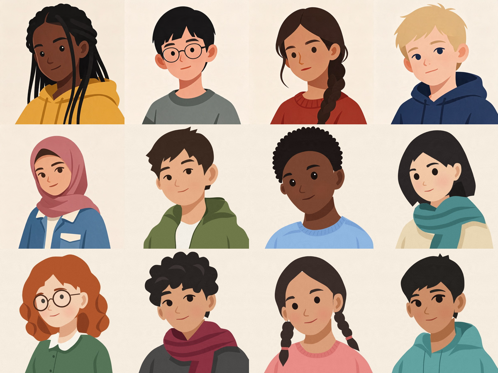

# paper-brush

An [Agent Skill](https://docs.claude.com/en/docs/agents-and-tools/agent-skills) for Claude that draws **flat cut-paper illustrations as code**: portraits, avatars, characters, simple scenes and banners.



The first five set the style; the other seven were drawn with this brush to join them, so that the new ones cannot be picked out of the set. That is what the skill is best at: extending a look you already have.

<sub>Example avatars © hanlianlu, all rights reserved: not covered by the MIT License (see below).</sub>

Every picture is a short stack of coloured paper shapes, each cut along a pen-tool path: a few nodes, long arcs, crisp corners. Depth comes from clean second-tone shapes (often one hard edge and one that fades), never from outlines or gradients; a soft blush is the only blur, and a fine paper grain goes over everything. The same drawing file always renders the same pixels, so a whole set stays in one hand and any shape can be nudged by editing a number. No image model involved.

The bundled example drawings render to these (yours to use):

<p> </p>

## Install

**Claude Code (plugin):**

```
/plugin marketplace add hanlianlu/paper-brush
/plugin install paper-brush@paper-brush
```

**As a plain skill:** copy `skills/paper-brush/` into `~/.claude/skills/` (Claude Code), or zip that folder and upload it under Settings → Capabilities → Skills on claude.ai.

Then ask Claude for something like *"draw a set of six cut-paper avatars for my app"* or *"use the paper brush to make a banner"*.

## What's inside

```
skills/paper-brush/
  SKILL.md                         when to use it, workflow, reusable face parts
  scripts/paper.py                 the renderer (numpy + OpenCV; `uv run` installs them)
  references/style.md              the style rules that make it read as paper
  references/example_drawings.py   a portrait and a banner to start from
examples/portraits/                twelve example avatars (all rights reserved, see License)
```

Render the examples yourself:

```bash
cd skills/paper-brush/references
uv run ../scripts/paper.py example_drawings.py out/
```

`uv run …/paper.py nodes MASK.png` turns a black-and-white mask into pen nodes, a quick start when tracing shapes off a sketch.

## License

- **Code and docs: [MIT](LICENSE).** Free to use, modify and ship, commercially too. Pictures you draw with it are yours.
- **Example avatars** (`examples/`, `docs/avatars.png`): © hanlianlu, **all rights reserved**. They are here to show the style; please don't copy, redistribute or use them in your own work. Draw your own instead, that's what the brush is for.
